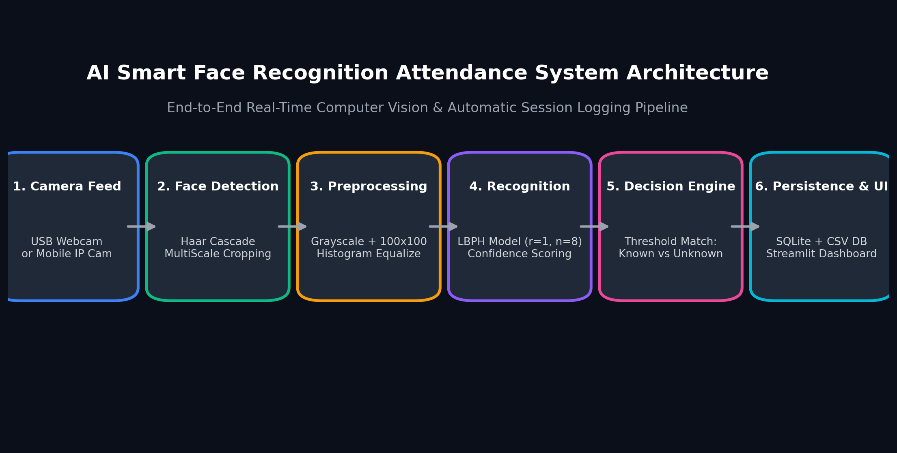
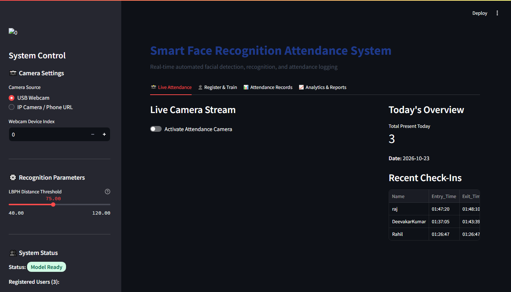
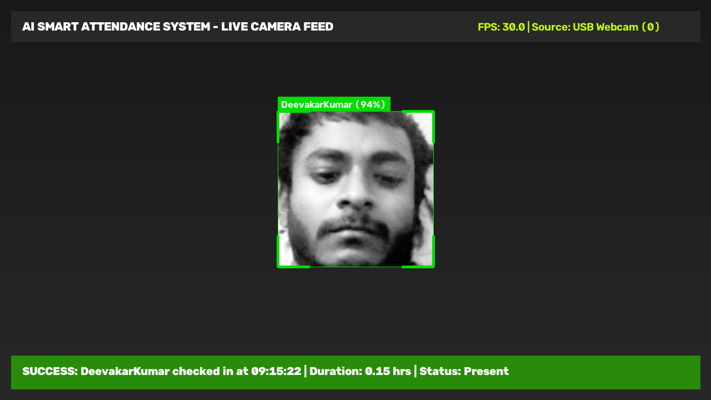
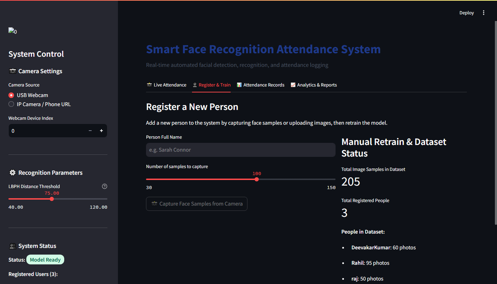
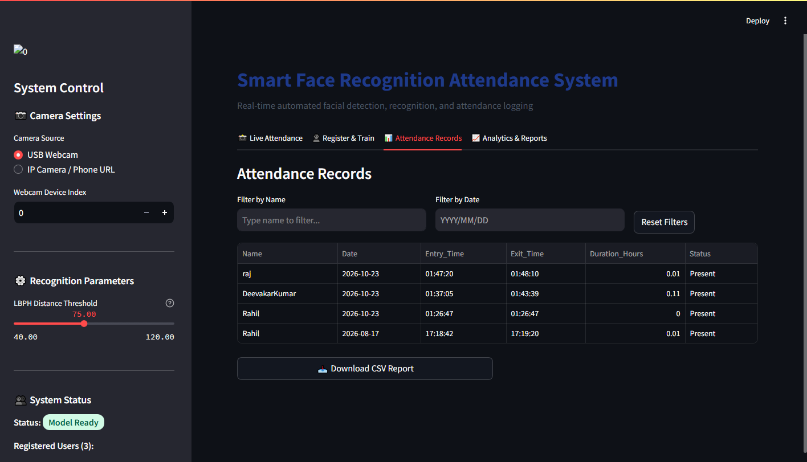
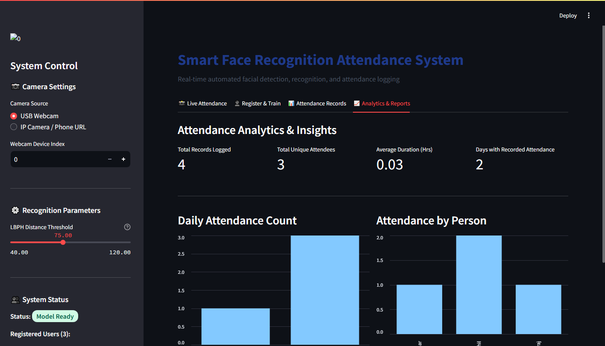

# 📸 AI Smart Face Recognition Attendance System

[](https://www.python.org/)
[](https://opencv.org/)
[](https://streamlit.io/)
[](https://www.sqlite.org/)
[](LICENSE)

An end-to-end, real-time Computer Vision and Deep Learning attendance management system. Automatically detects faces from a local USB webcam or mobile IP camera, recognizes registered individuals with confidence thresholding, rejects unauthorized/unknown faces, and logs check-ins, exits, and session durations into persistent CSV and SQLite databases.

Equipped with both a **modern interactive Streamlit web dashboard** and **modular standalone command-line scripts** for seamless use in VS Code or production environments.

---

## 🖼️ Application Screenshots & Visual Showcase

### 1. System Architecture & Processing Pipeline


---

### 2. Live Face Recognition & Camera Stream
Real-time face detection with stylized bounding boxes, dynamic confidence score display, and on-screen check-in notification banners.

| Live Attendance Camera Feed | Real-Time Detection Overlay |
| :---: | :---: |
|  |  |

---

### 3. User Registration & Instant Model Training
Register a new person, capture face crops directly through the camera with real-time visual progress, and automatically retrain the model with one click.



---

### 4. Attendance Records, Filtering & CSV Export
Filter attendance logs by person name or specific dates, inspect session start times, exit times, and calculated duration hours, and download reports with one click.



---

### 5. Attendance Analytics & Insights
Visual breakdown of daily attendance patterns and attendance frequency per person.



---

## 🌟 Key Features

- **⚡ Real-Time Face Detection & Recognition**: Powered by Haar Cascade detection and high-speed Local Binary Patterns Histograms (LBPH) with confidence scoring.
- **🛡️ Unknown Face Rejection**: Automatically tags unrecognized or low-confidence faces as `"Unknown"` (red bounding box), preventing false check-ins.
- **📊 Modern Web Dashboard (Streamlit)**:
  - **Live Attendance Feed**: Real-time bounding boxes (Green for recognized, Red for unknown) and instant on-screen check-in alerts.
  - **1-Click User Registration**: Input name, capture face samples via camera with a visual progress bar, and automatically retrain the model.
  - **Records & Analytics**: Filter logs by name or date, view attendance statistics, and export to CSV with one click.
  - **Camera & Model Controls**: Seamlessly switch between USB Webcam and IP phone cameras (`http://...`), tune confidence thresholds, and trigger manual model retraining.
- **💾 Crash-Proof & Deduplicated Logging**: Dual persistence with SQLite (`data/attendance.db`) and CSV (`attendance.csv`). Tracks first entry, continuous presence, exit time, and calculated hours with cooldown protection.
- **📱 Flexible Camera Support**: Works with standard laptop/USB webcams and IP cameras (such as the IP Webcam mobile app).
- **💻 VS Code & Terminal Ready**: Clean modular architecture with standalone scripts for each step in `scripts/`.

---

## 🏗️ Project Architecture

```
proj/
├── app.py                      # Interactive Streamlit Web Dashboard
├── run_app.bat                 # 1-Click launcher for Windows
├── haarcascade_frontalface_default.xml # Haar Cascade face detector
├── attendance.csv              # Formatted CSV attendance log
├── requirements.txt            # Python dependencies
├── .gitignore                  # Git ignore rules
├── README.md                   # Complete project documentation
│
├── core/                       # Core engine modules
│   ├── __init__.py
│   ├── config.py               # Dynamic paths and system parameters
│   ├── camera.py               # Camera stream handler (Webcam + IP Camera)
│   ├── detector.py             # Face detector with styled bounding boxes
│   ├── recognizer.py           # LBPH recognizer with confidence & unknown rejection
│   ├── trainer.py              # Automated dataset trainer and label mapper
│   └── attendance_manager.py   # Database & CSV session logger with cooldowns
│
├── scripts/                    # Standalone CLI tools (for VS Code / Terminal)
│   ├── 1_collect_data.py       # Register a new person and capture photos
│   ├── 2_train_model.py        # Train/retrain the recognition model
│   ├── 3_attendance_system.py  # Live camera attendance runner
│   └── 4_view_records.py       # Quick terminal attendance viewer
│
├── screenshots/                # Project visual demonstrations & architecture
│   ├── 01_live_attendance_tab.png
│   ├── 02_user_registration_tab.png
│   ├── 03_attendance_records_tab.png
│   ├── 04_analytics_charts_tab.png
│   ├── 05_live_detection_demo.png
│   └── 06_system_architecture.png
│
├── data/
│   ├── models/                 # Trained models and labels.json
│   └── attendance.db           # SQLite database for persistent records
└── proje/                      # Captured dataset of face images
```

---

## 🚀 Quick Start Guide

### 1. Installation

Clone the repository and install the required dependencies:

```bash
git clone https://github.com/deevakarkumar/face-recognition-attendance-system.git
cd face-recognition-attendance-system

pip install -r requirements.txt
```

> **Note**: For Windows users with Anaconda, activate your environment first (e.g. `conda activate base`).

---

### 2. Launch the Web Application (Recommended)

Simply double-click **`run_app.bat`** (on Windows) or run:

```bash
streamlit run app.py
```

This will launch the web dashboard at `http://localhost:8501`:
1. Navigate to **📸 Live Attendance** to start logging attendance.
2. Go to **👤 Register & Train** to add new people and capture their face samples.
3. Review logs, search by name or date, and download reports in **📊 Attendance Records**.
4. Check attendance frequency and metrics in **📈 Analytics & Reports**.

---

### 3. Running from VS Code / Terminal (CLI Workflow)

If you prefer running standalone Python scripts directly in VS Code:

#### Step 1: Register a New Person
```bash
python scripts/1_collect_data.py
```
*Prompts for name and camera source, captures 100 face samples to `proje/`, and asks if you want to auto-train.*

#### Step 2: Train the Model
```bash
python scripts/2_train_model.py
```
*Scans all images in `proje/`, assigns labels, and trains the model in seconds.*

#### Step 3: Run the Live Attendance Tracker
```bash
python scripts/3_attendance_system.py
```
*Opens real-time camera stream, displays recognized names and confidence, and logs attendance to `attendance.csv`.*

#### Step 4: View Records
```bash
python scripts/4_view_records.py
```
*Displays summary of today's attendance and historical logs in terminal.*

---

## 🛠️ Technical Details

### 1. Face Detection & Preprocessing
- Frames are captured via `core/camera.py` at high framerate.
- `haarcascade_frontalface_default.xml` detects frontal face regions.
- Detected faces are cropped, converted to grayscale, resized to $100 \times 100$, and normalized using histogram equalization (`cv2.equalizeHist`) to handle varying lighting conditions.

### 2. Feature Extraction & Classification (LBPH)
- The **Local Binary Patterns Histograms (LBPH)** algorithm extracts micro-texture spatial features from the face.
- Outputs `(predicted_id, distance)`:
  - **Distance $\le 75$**: Identified as the registered individual.
  - **Distance $> 75$**: Rejected as `"Unknown"`.
  - Confidence percentage is displayed as $\max(0, 100 - \text{distance})\%$.

### 3. Session & Attendance Algorithm
- **First Detection of the Day**: Logs check-in timestamp (`Entry_Time`), sets status to `Present`, and initiates session.
- **Continuous Presence**: Updates `Exit_Time` and calculates total session duration in hours:
  $$\text{Duration (Hours)} = \frac{\text{Exit Time} - \text{Entry Time}}{3600}$$
- **Cooldown Protection**: Configurable cooldown (default 5 minutes) prevents repetitive check-in alerts while maintaining session accuracy.

---

## 📋 Attendance File Schema

The system automatically writes to [`attendance.csv`](file:///attendance.csv) and SQLite:

| Column | Description | Example |
| :--- | :--- | :--- |
| `Name` | Person's registered name | `DeevakarKumar` |
| `Date` | Date of attendance (`YYYY-MM-DD`) | `2026-10-23` |
| `Entry_Time` | First recognized timestamp (`HH:MM:SS`) | `09:15:30` |
| `Exit_Time` | Last recognized timestamp (`HH:MM:SS`) | `17:45:10` |
| `Duration_Hours` | Total time spent in hours | `8.50` |
| `Status` | Attendance status | `Present` |

---

## 👤 Author

**Deevakar Kumar**
- GitHub: [@deevakarkumar](https://github.com/deevakarkumar)
- Repository: [face-recognition-attendance-system](https://github.com/deevakarkumar/face-recognition-attendance-system)

---

## 📄 License

This project is open-source under the [MIT License](LICENSE).
